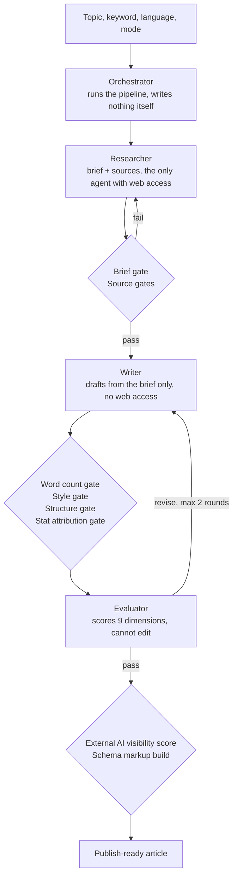

# AEO Article Pipeline

**A multi-agent AI system that turns a topic into a finished, publishable article built to be cited by AI assistants (ChatGPT, Perplexity, Google AI Overviews), with automatic quality checks between every step.**

Built and run by Predrag (PJ) Arandjelovic, Lux Digital Consulting.

This repository is a public showcase. It contains the architecture overview, a real finished article with its quality reports, and two of the quality-check scripts. The agent instructions and the house-style rules are proprietary and are not included.

---

## The problem it solves

Most AI-written content fails in the same three ways:

- **It sounds like AI.** Same phrases, same rhythm, nothing a reader remembers.
- **It makes things up.** Statistics with no source, or sources that do not exist.
- **It is not built for AI search.** People now ask ChatGPT and Perplexity instead of Google. An article only gets cited there if it gives short, clear, well-sourced answers in a structure a model can lift.

Asking one AI model to "write a good article" does not fix any of this. The model forgets rules halfway through, grades its own work generously, and cannot count reliably.

## How it works

Four specialised AI agents split the work, the way a small content team would. Between them sit scripts that check the work mechanically. A script does not get tired, does not forget a rule and does not grade its own homework.



### The four agents

| Agent | Job | Why it is separate |
|---|---|---|
| **Orchestrator** | Runs the 16-step pipeline, delegates, runs every gate | Coordination is not writing, so it runs on a cheaper model |
| **Researcher** | Builds the brief and the source list | The only agent allowed on the web, so every fact has a traceable source |
| **Writer** | Writes the draft from the brief | Has no web access, so it cannot invent new "facts" mid-draft |
| **Evaluator** | Scores the draft on nine dimensions | Has no write access, so it can judge but never quietly fix its own findings |

### The nine quality gates

| Gate | What it checks | What happens on a fail |
|---|---|---|
| Brief check | The research brief is complete | Back to the researcher, one repair round |
| Source verification | Every source URL actually resolves | Dead links go back to the researcher for replacement |
| Source depth | Real documents, not homepages; enough different domains | Back to the researcher, one repair round |
| Word count | Length fits the article type | Back to the writer, max 2 rounds |
| Style lint | 137 banned AI phrases, em dashes, semicolons, wall-of-text paragraphs | Feeds the evaluator's voice score |
| Structure | Question headings, answer length, answer cards, FAQ, tables, visuals | Feeds the evaluator's structure score |
| Stat attribution | Every statistic names its source | Feeds the evaluator's sourcing score |
| AI visibility score | External scoring of how citable the article is for AI engines | Max 2 calls per article |
| Schema build | Generates the JSON-LD (Article + FAQ) for the page | Blocks publishing if the metadata is invalid |

### The evaluator's nine dimensions

Brief adherence, AEO structure, fact density, sourcing, information gain, argument, reader value, voice, ending order.

Any critical finding, or two or more dimensions below 8 out of 10, sends the draft back to the writer. Hard cap of two revision rounds, so a run always ends.

---

## A real example

[`examples/hubspot-attribution-model/`](examples/hubspot-attribution-model/) contains a shipped article, *How to Choose the Right HubSpot Attribution Model*, with every report the pipeline produced for it:

| File | What it shows |
|---|---|
| [`article.md`](examples/hubspot-attribution-model/article.md) | The final article, with frontmatter for the schema build. `[VISUAL: ...]` lines are briefs for the designer. |
| [`evaluation.md`](examples/hubspot-attribution-model/evaluation.md) | The evaluator's scorecard: 8 to 10 on all nine dimensions, verdict PASS, plus findings with exact fixes |
| [`structure-check-report.txt`](examples/hubspot-attribution-model/structure-check-report.txt) | Structure gate output: 0 failures |
| [`lint-style-report.txt`](examples/hubspot-attribution-model/lint-style-report.txt) | Style gate output: 0 banned terms, 0 punctuation issues |

**Why the layers matter, shown in this example.** The structure script counted the last FAQ answer at 52 words and passed it. The evaluator read the article and saw the real answer was 26 words: the script had counted the P.S. lines as part of the answer. The evaluator flagged it with an exact fix and logged the script's blind spot to its memory. Scripts catch what models miss, and models catch what scripts miss. Neither is trusted alone.

---

## Run the two included gates yourself

Requires bash and awk (Linux, macOS, or WSL on Windows).

```bash
bash scripts/structure-check.sh examples/hubspot-attribution-model/article.md standard
bash scripts/lint-style.sh examples/hubspot-attribution-model/article.md
```

Both exit with `0` on a pass and `1` on a fail, with line numbers for every problem.

---

## Numbers from real runs

- **Cost per article:** $28.64 on the first run. Moving the orchestrator to a lighter model cut it to **$6.83 to $7.51 per article, with equal or better scores**. Only the writer runs on the top-tier model, because writing is the product.
- **Cheaper is not always cheaper:** a lower-priced model provider cost more per article ($8.14) and took about four times longer. Model choice is measured, not assumed.
- **Article length:** standard articles are 1,800 to 2,200 words with 6 to 9 sections; pillar articles are 3,500+ words.

## Honest limits

- **The pipeline cannot invent expertise.** With no client story, data or point of view supplied, the information gain score tops out around 5 out of 10. That was measured on a deliberate control run. The best articles come from real client material, which the pipeline takes in through a notes file.
- **Gates check structure, not truth.** Sources are verified and attributed, but a human still reads the final article before it goes live.

---

## What is not in this repository

The agent instructions, the house-style rules, the orchestration logic and the model configuration are proprietary to Lux Digital Consulting. This repository shows what the system does and the quality of what it produces, not how to rebuild it.

© Lux Digital Consulting. Shared for review purposes. Not licensed for reuse.

**Contact:** Predrag Arandjelovic · [LinkedIn](https://www.linkedin.com/in/predrag-arandjelovic/) · predrag.arandjelovic@luxdigitalconsulting.rs
